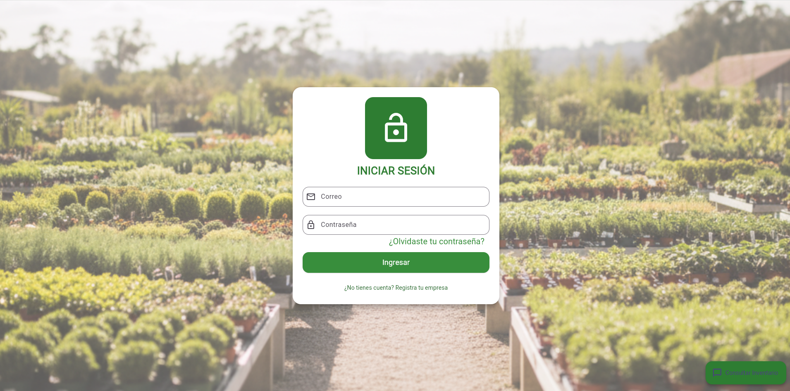

🌿 Inventivo - Sistema de Gestión de Inventarios para Viveros

Inventivo es una solución tecnológica diseñada para la digitalización y el control eficiente de inventarios en viveros. Desarrollada para la región del Sumapaz, con énfasis en la zona de Chinauta, Cundinamarca, la plataforma busca resolver la falta de herramientas accesibles para el manejo y monitoreo de la producción vegetal en comercios locales.

📌 Problema y Solución

Muchos viveristas de la región operan sin un sistema automatizado para registrar sus existencias, ventas y tipos de plantas, lo que puede generar pérdidas de información y descontrol operativo.

Inventivo centraliza y automatiza estos procesos mediante las siguientes funcionalidades:

🔐 Autenticación segura y control de acceso por usuarios.

📦 Operaciones CRUD completas para la gestión de inventario de plantas y productos.

🌐 Acceso desde la plataforma web y compatibilidad con dispositivos móviles.

🛠️ Stack Tecnológico

Frontend: Flutter (Dart).

Backend: API REST propia desarrollada en PHP.

Base de datos: MySQL, administrada mediante phpMyAdmin.

Diseño UI/UX: Figma.

📸 Vista Previa

Prototipo en Figma

Pantalla de Inicio

Pantalla de Login

⚙️ Requisitos Previos e Instalación

Requisitos

Antes de ejecutar el proyecto, asegúrate de contar con las siguientes herramientas:
* Flutter SDK: versión 3.0.0 o superior.
* Dart SDK.
* Servidor web local: XAMPP, WAMP o Laragon, con PHP y MySQL habilitados.
* Android Studio: opcional, para compilar y ejecutar la aplicación en Android.
* Google Chrome: para ejecutar la versión web.
Pasos de configuración local

1. Clonar el repositorio

git clone https://github.com/natalia482/inventivo.git
cd inventivo

2. Configurar el backend y la base de datos

Inicia los servicios de Apache y MySQL desde tu servidor local (XAMPP, WAMP o Laragon).

Abre phpMyAdmin en tu navegador: http://localhost/phpmyadmin.

Crea una nueva base de datos con el nombre bd_inventivo.

Selecciona la base de datos creada e importa el archivo SQL bd_inventivo.sql.

Ubica los archivos del backend en la carpeta de tu servidor web local. Por ejemplo:

C:\xampp\htdocs\inventivo-api

Actualiza las credenciales de conexión a la base de datos en los archivos PHP, si es necesario (host, usuario, contraseña y nombre de la base de datos).

3. Instalar las dependencias de Flutter

Desde la raíz del proyecto, ejecuta:

flutter pub get

4. Ejecutar la aplicación

En navegador web (Google Chrome):

flutter run -d chrome

En un emulador Android o dispositivo móvil:

flutter run

👥 Autores y Créditos

Este proyecto fue desarrollado como trabajo de grado en la Universidad de Cundinamarca.

Natalia Villalobos

Ingeniera de Sistemas y Computación

GitHub: @natalia482

LinkedIn: Briyit Natalia Villalobos Rodríguez

Jesús Aguirre

Ingeniero de Sistemas y Computación

GitHub: @JesusDAguirre

📜 Propiedad Intelectual y Publicación

Registro Nacional: El software cuenta con registro oficial ante la Dirección Nacional de Derecho de Autor (DNDA) de Colombia.

Publicación académica: La tesis completa puede consultarse en el Repositorio Institucional de la Universidad de Cundinamarca.

Desarrollado con dedicación para contribuir a la transformación digital del sector viverista de la región del Sumapaz.