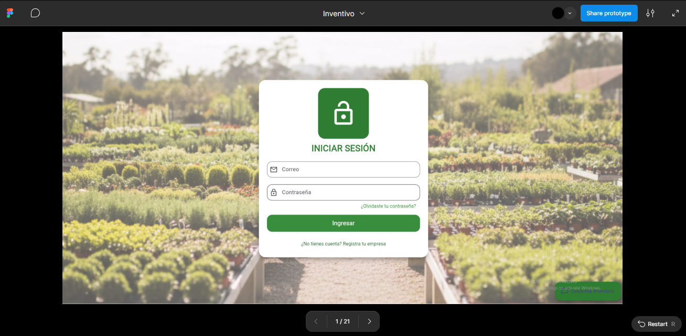

 <div align="center">


# 🌿 INVENTIVO

### Sistema de Gestión de Inventarios para Viveros

**Tecnología que transforma la gestión de los viveros.**

Digitalización, organización y control inteligente de inventarios, plantas, insumos y remisiones para viveros de la región del Sumapaz.

<br>

<a href="https://inventivo-viveros.onrender.com">
  
</a>
<a href="https://inventivo.onrender.com/plantas/listar.php?id_sede=10">
  
</a>
<a href="https://repositorio.ucundinamarca.edu.co/items/36d9ba09-f551-4e5d-9a89-40fdbc981e68">
  
</a>

<br><br>


<br>

**Desarrollado en Chinauta, Cundinamarca, Colombia 🇨🇴**

</div>

---

## 🌱 Sobre el proyecto

**INVENTIVO** es una solución tecnológica orientada a la transformación digital de los procesos administrativos y operativos de los viveros.

El proyecto surge como respuesta a las necesidades identificadas en viveros de **Chinauta, Cundinamarca**, donde la gestión manual de inventarios puede dificultar el control de existencias, el seguimiento de insumos y la administración de las operaciones comerciales.

La plataforma integra herramientas de gestión, automatización y consulta en un solo entorno digital, permitiendo mejorar la organización de la información y facilitar la toma de decisiones.

<div align="center">

### 🌿 Del cultivo a la transformación digital

*Una herramienta tecnológica para fortalecer la gestión de los viveros.*

</div>

## 🎯 Problema y solución

En muchos viveros, el registro manual de plantas, insumos y movimientos comerciales puede ocasionar pérdida de información, inconsistencias en las existencias y dificultades para realizar un seguimiento de las operaciones.

**INVENTIVO centraliza estos procesos mediante una plataforma multiplataforma**, diseñada para facilitar la administración y el control de los recursos de cada vivero.

## ✨ Funcionalidades principales

<table>
<tr>
<td width="50%" valign="top">

### 🔐 Autenticación y usuarios

- Inicio de sesión.
- Gestión de roles y permisos.
- Perfiles de Propietario, Administrador y Trabajador.
- Administración de información por empresa y sede.

</td>
<td width="50%" valign="top">

### 🌿 Gestión de plantas

- Registro y actualización de plantas.
- Consulta y búsqueda de productos.
- Control de cantidades disponibles.
- Administración de precios y existencias.

</td>
</tr>
<tr>
<td width="50%" valign="top">

### 🧪 Gestión de insumos

- Registro de insumos agrícolas.
- Clasificación por categorías.
- Control de cantidades y medidas.
- Alertas de disponibilidad y abastecimiento.

</td>
<td width="50%" valign="top">

### 🧾 Remisiones y comprobantes

- Generación de remisiones.
- Cálculo automático de totales.
- Generación de documentos PDF.
- Actualización de existencias según movimientos.

</td>
</tr>
<tr>
<td width="50%" valign="top">

### 📊 Control y trazabilidad

- Historial de movimientos.
- Registro de actividades.
- Seguimiento de operaciones por usuario.
- Panel de información y estadísticas.

</td>
<td width="50%" valign="top">

### 🤖 Asistente virtual

- Chatbot integrado.
- Apoyo en consultas operativas.
- Asistencia dentro de la plataforma.

</td>
</tr>
</table>

## 🛠️ Tecnologías utilizadas

<div align="center">

| Área | Tecnología |
|:---:|:---|
| Frontend | Flutter / Dart |
| Backend | PHP 8.2 |
| Arquitectura | API REST / MVC |
| Acceso a datos | PDO |
| Base de datos | MySQL |
| Administración BD | phpMyAdmin |
| Diseño UI/UX | Figma |
| Contenedores | Docker |
| Despliegue frontend | Render |
| Despliegue backend | Render |
| Base de datos en producción | Clever Cloud |

</div>

## 🚀 Demo en vivo

<div align="center">

### ¡Explora INVENTIVO!

<a href="https://inventivo-viveros.onrender.com">
  
</a>

</div>

Puedes ingresar a la plataforma utilizando las siguientes credenciales de demostración:

| Rol | Correo electrónico | Contraseña |
|:---:|:---|:---|
| Propietario / Administrador | `inventivoprueba@gmail.com` | `password` |

> **Nota:** El backend está alojado en una instancia gratuita de Render. Después de aproximadamente 15 minutos de inactividad, la primera petición puede tardar alrededor de 30 segundos mientras el servidor vuelve a activarse.

## 📸 Vista previa del sistema

<div align="center">

### 🎨 Diseño y experiencia de usuario

**Prototipo de diseño en Figma**



<br><br>

### 🏡 Pantalla principal


<br><br>

### 🔑 Inicio de sesión


</div>

---

## ⚙️ Instalación y configuración local

### 📋 Requisitos previos

Antes de ejecutar el proyecto, asegúrate de contar con:

- [Flutter SDK](https://docs.flutter.dev/get-started/install) (versión 3.0.0 o superior).
- Dart SDK.
- [XAMPP](https://www.apachefriends.org/) o servidor equivalente con PHP y MySQL.
- [Android Studio](https://developer.android.com/studio) (opcional, para Android).
- Google Chrome (para la versión web).
- Git.

### 1. Clonar el repositorio

```bash
git clone https://github.com/natalia482/Inventivo-Viveros-Tesis.git

cd Inventivo-Viveros-Tesis
```

### 2. Configurar el backend y la base de datos

1. Inicia Apache y MySQL desde XAMPP.
2. Abre phpMyAdmin:

   `http://localhost/phpmyadmin`

3. Crea la base de datos con el nombre:

   `bd_inventivo`

4. Importa el archivo SQL incluido en el proyecto.
5. Ubica los archivos del backend en el directorio de tu servidor local. Por ejemplo:

   `C:\xampp\htdocs\inventivo_backend`

6. Configura las credenciales de conexión en `config/conexion.php`:

   - Host.
   - Usuario.
   - Contraseña.
   - Nombre de la base de datos.

### 3. Instalar dependencias de Flutter

Desde la raíz del proyecto ejecuta:

```bash
flutter pub get
```

### 4. Ejecutar la aplicación

**Versión web:**

```bash
flutter run -d chrome
```

**Versión móvil:**

```bash
flutter run
```

> **Importante:** Verifica que la URL base de la API en la configuración de Flutter corresponda a tu servidor local y no al entorno de producción.

---

## 📜 Propiedad intelectual y publicación académica

INVENTIVO cuenta con reconocimiento y documentación de su desarrollo tanto en el ámbito académico como en el de propiedad intelectual.

<div align="center">

### 🎓 Universidad de Cundinamarca

Trabajo de grado desarrollado en el programa de Ingeniería de Sistemas y Computación.

<a href="https://repositorio.ucundinamarca.edu.co/items/36d9ba09-f551-4e5d-9a89-40fdbc981e68">
  
</a>

<br><br>

### © Registro de derechos de autor

Registro ante la Dirección Nacional de Derecho de Autor (DNDA) de Colombia.

**Registro N.º 13-106-362**

</div>

---

## 👩‍💻 Autores y desarrolladores

<div align="center">

Este proyecto fue desarrollado como trabajo de grado en la Universidad de Cundinamarca, integrando conocimientos de ingeniería, desarrollo de software e innovación tecnológica.

<br>

### 👩‍💻 Natalia Villalobos

**Ingeniera de Sistemas y Computación**

<a href="https://github.com/natalia482">
  
</a>
<a href="https://www.linkedin.com/search/results/people/?keywords=Briyit%20Natalia%20Villalobos%20Rodr%C3%ADguez">
  
</a>

<br><br>

### 👨‍💻 Jesús Aguirre

**Ingeniero de Sistemas y Computación**

<a href="https://github.com/JesusDAguirre">
  
</a>
<a href="https://www.linkedin.com/" target="_blank">
  
</a>

</div>
---

<div align="center">


### 🌿 INVENTIVO

**Cultivando tecnología, cosechando soluciones.**

Desarrollado con dedicación en Chinauta, Cundinamarca, Colombia 🇨🇴

<sub>© INVENTIVO — Todos los derechos reservados.</sub>

</div>
